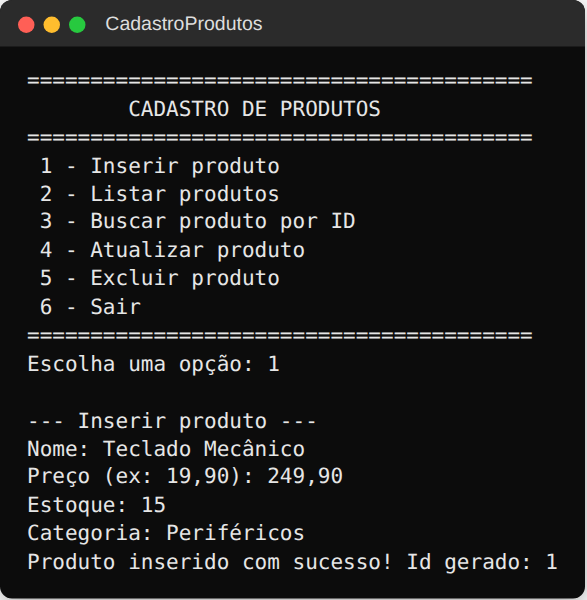
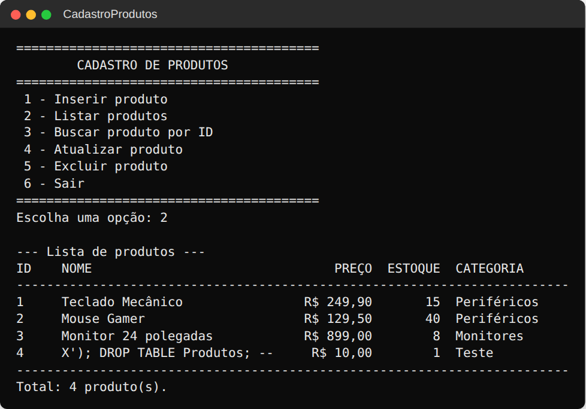
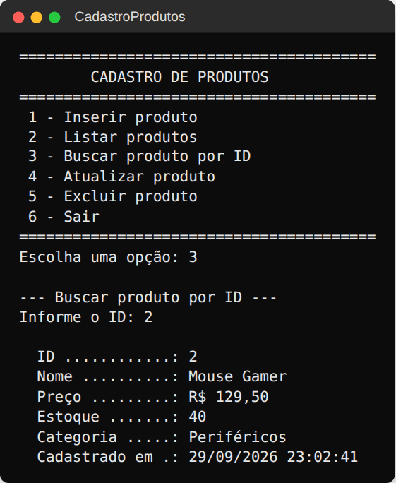
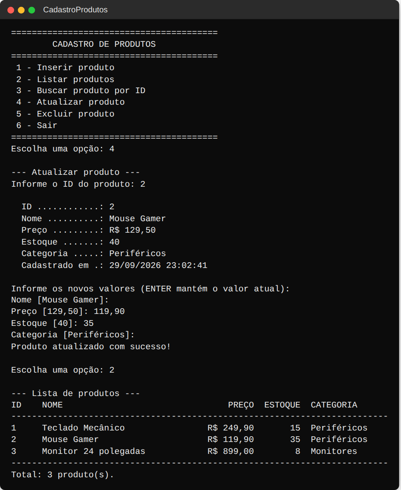
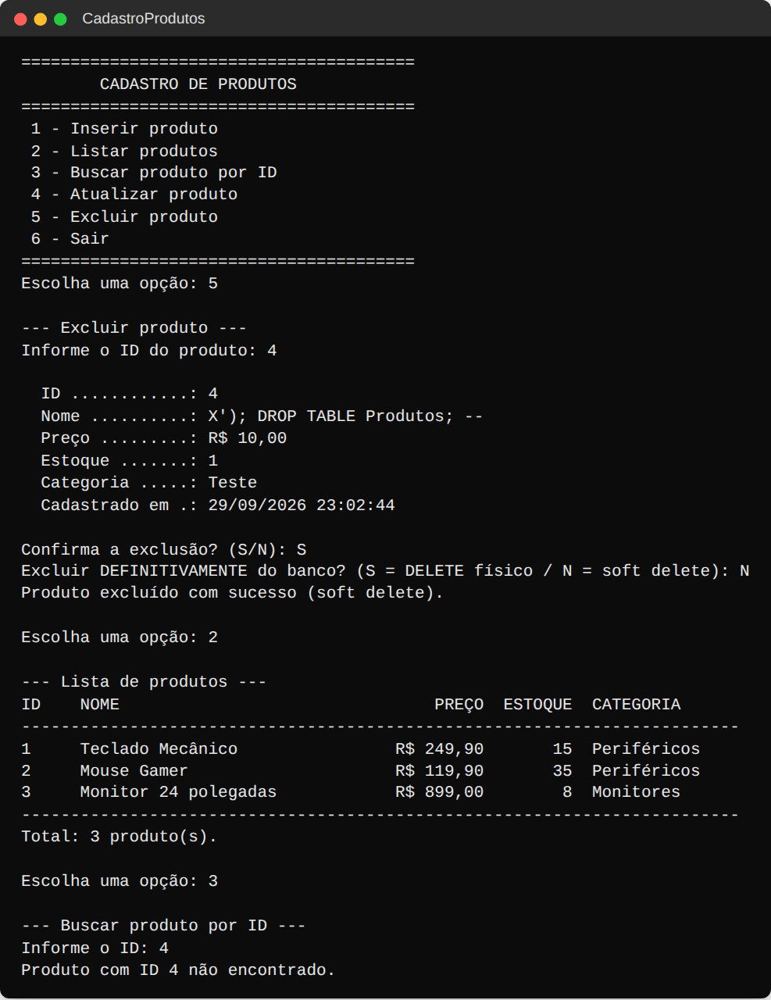
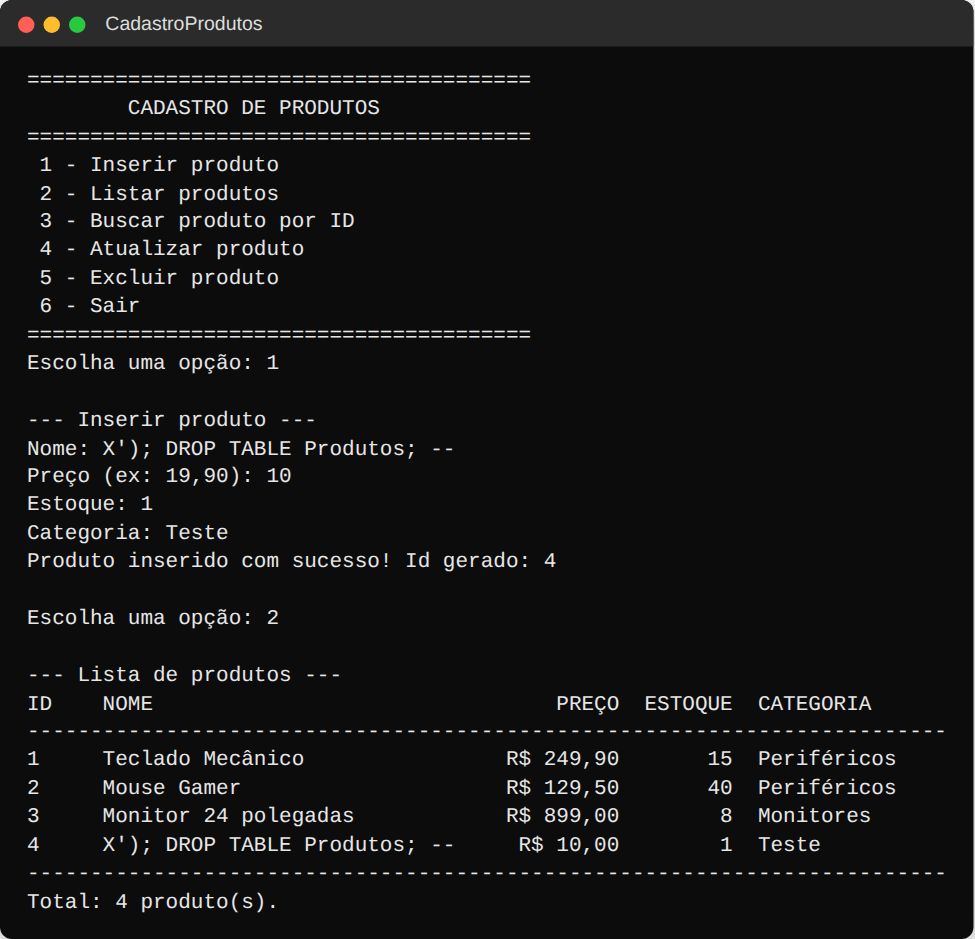
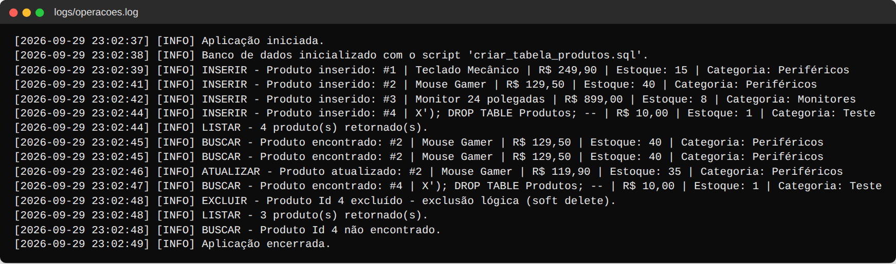
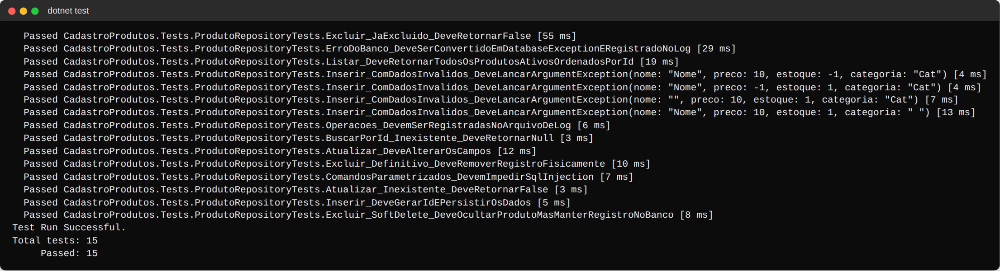

# Checkpoint 5 — CRUD de Produtos com ADO.NET

Aplicação console em **C# (.NET 8)** para cadastrar e gerenciar produtos, usando
**ADO.NET puro** (`Microsoft.Data.Sqlite`) para acessar um banco **SQLite**.

## Funcionalidades

Menu interativo com as opções:

1. Inserir produto
2. Listar produtos
3. Buscar produto por ID
4. Atualizar produto
5. Excluir produto
6. Sair

### Requisitos atendidos

| Requisito | Onde |
|---|---|
| Banco SQLite | `Microsoft.Data.Sqlite` (provider ADO.NET) |
| Script `.sql` de criação da tabela | [`database/criar_tabela_produtos.sql`](database/criar_tabela_produtos.sql) |
| Connection string no `appsettings.json` | [`src/CadastroProdutos/appsettings.json`](src/CadastroProdutos/appsettings.json) |
| Classe `Produto` | [`Models/Produto.cs`](src/CadastroProdutos/Models/Produto.cs) |
| Classe `ProdutoRepository` (acesso ao banco) | [`Data/ProdutoRepository.cs`](src/CadastroProdutos/Data/ProdutoRepository.cs) |
| Métodos `Inserir`, `Listar`, `BuscarPorId`, `Atualizar`, `Excluir` | `ProdutoRepository` |
| `ExecuteNonQuery` em INSERT / UPDATE / DELETE | `Inserir`, `Atualizar`, `Excluir` |
| `ExecuteReader` em SELECT | `Listar`, `BuscarPorId` (e leitura do Id gerado em `Inserir`) |
| Mapeamento manual `DataReader` → `Produto` | método `Mapear` do repositório |
| Comandos parametrizados (anti SQL Injection) | todos os comandos usam `@Parametros` |
| Tratamento de exceções de banco | `SqliteException` é registrada no log e convertida em `DatabaseException`, tratada no menu |
| Log das operações em arquivo | [`Logging/FileLogger.cs`](src/CadastroProdutos/Logging/FileLogger.cs) → `logs/operacoes.log` |

### Bônus implementados

- **Testes unitários** (xUnit) — [`tests/CadastroProdutos.Tests`](tests/CadastroProdutos.Tests), 15 testes cobrindo CRUD, soft delete, SQL Injection, validação, tratamento de erro e log.
- **Transações** — `Inserir`, `Atualizar` e `Excluir` rodam dentro de `BeginTransaction()` com `Commit`/`Rollback`.
- **Soft delete** — a exclusão padrão marca `Ativo = 0` e preenche `DataExclusao`; o produto some da listagem/busca mas continua no banco. O menu também oferece a exclusão definitiva (`DELETE` físico).

## Estrutura

```
├── CadastroProdutos.sln
├── database/
│   └── criar_tabela_produtos.sql     # script de criação da tabela
├── docs/prints/                      # prints das operações
├── src/CadastroProdutos/
│   ├── appsettings.json              # connection string
│   ├── Program.cs                    # configuração e inicialização
│   ├── Menu.cs                       # menu do console
│   ├── Models/Produto.cs
│   ├── Data/
│   │   ├── ProdutoRepository.cs      # CRUD com ADO.NET
│   │   ├── DatabaseInitializer.cs    # executa o script .sql
│   │   └── DatabaseException.cs
│   └── Logging/FileLogger.cs
└── tests/CadastroProdutos.Tests/     # testes xUnit
```

## Tabela `Produtos`

```sql
CREATE TABLE IF NOT EXISTS Produtos (
    Id            INTEGER PRIMARY KEY AUTOINCREMENT,
    Nome          TEXT    NOT NULL CHECK (length(trim(Nome)) > 0),
    Preco         NUMERIC NOT NULL CHECK (Preco >= 0),
    Estoque       INTEGER NOT NULL CHECK (Estoque >= 0),
    Categoria     TEXT    NOT NULL CHECK (length(trim(Categoria)) > 0),
    Ativo         INTEGER NOT NULL DEFAULT 1 CHECK (Ativo IN (0, 1)),
    DataCadastro  TEXT    NOT NULL DEFAULT (datetime('now', 'localtime')),
    DataExclusao  TEXT    NULL
);
```

`Ativo` e `DataExclusao` existem para o soft delete; `DataCadastro` é preenchida automaticamente.

## Como configurar e executar

### Pré-requisitos

- [.NET SDK 8.0](https://dotnet.microsoft.com/download/dotnet/8.0) (Windows, Linux ou macOS)
- Não é preciso instalar servidor de banco: o SQLite é embutido via pacote NuGet.

### Passo a passo

```bash
git clone <url-do-repositorio>
cd C-Checkpoint-5---CRUD-com-ADO.NET

dotnet restore
dotnet run --project src/CadastroProdutos
```

Na primeira execução a aplicação lê o `appsettings.json`, cria o arquivo `produtos.db`
e executa o script `database/criar_tabela_produtos.sql` (idempotente — `CREATE TABLE IF NOT EXISTS`).

> O banco (`produtos.db`) e o log (`logs/operacoes.log`) ficam na pasta de saída do
> executável, por exemplo `src/CadastroProdutos/bin/Debug/net8.0/`.

### Configuração (`appsettings.json`)

```json
{
  "ConnectionStrings": {
    "ProdutosDb": "Data Source=produtos.db"
  },
  "Logging": {
    "ArquivoLog": "logs/operacoes.log"
  },
  "Database": {
    "ScriptCriacao": "database/criar_tabela_produtos.sql"
  }
}
```

Para usar outro arquivo de banco, altere `Data Source` (caminho relativo à pasta do executável ou absoluto).

### Criar a tabela manualmente (opcional)

```bash
sqlite3 produtos.db < database/criar_tabela_produtos.sql
```

### Rodar os testes

```bash
dotnet test
```

Os testes criam um banco SQLite temporário a partir do mesmo script `.sql` e o removem ao final.

## Segurança: prevenção contra SQL Injection

Nenhum valor digitado pelo usuário é concatenado no SQL. Exemplo do repositório:

```csharp
command.CommandText = "SELECT ... FROM Produtos WHERE Id = @Id AND Ativo = 1;";
command.Parameters.AddWithValue("@Id", id);
```

No print [`06-sql-injection-bloqueado.png`](docs/prints/06-sql-injection-bloqueado.png) o nome
`X'); DROP TABLE Produtos; --` é gravado literalmente como texto, e a tabela continua intacta.

## Tratamento de exceções

- Cada método do `ProdutoRepository` captura `SqliteException`, registra o erro no log
  (`[ERRO]`) e lança uma `DatabaseException` com mensagem amigável, mantendo a exceção
  original em `InnerException`.
- O `Menu` captura `DatabaseException` (erro de banco) e `ArgumentException` (validação),
  exibe a mensagem e continua funcionando, sem encerrar a aplicação.
- Falhas ao ler o `appsettings.json` ou ao inicializar o banco são tratadas no `Program.cs`.
- Entradas inválidas (texto no lugar de número, preço/estoque negativos) são revalidadas no console.

## Log de operações

Todas as operações são registradas em `logs/operacoes.log`:

```
[2026-09-29 23:02:37] [INFO] Aplicação iniciada.
[2026-09-29 23:02:39] [INFO] INSERIR - Produto inserido: #1 | Teclado Mecânico | R$ 249,90 | Estoque: 15 | Categoria: Periféricos
[2026-09-29 23:02:46] [INFO] ATUALIZAR - Produto atualizado: #2 | Mouse Gamer | R$ 119,90 | Estoque: 35 | Categoria: Periféricos
[2026-09-29 23:02:48] [INFO] EXCLUIR - Produto Id 4 excluído - exclusão lógica (soft delete).
[2026-09-29 23:02:48] [INFO] BUSCAR - Produto Id 4 não encontrado.
```

## Prints

### 1. Inserir produto


### 2. Listar produtos


### 3. Buscar produto por ID


### 4. Atualizar produto


### 5. Excluir produto (soft delete)


### 6. Tentativa de SQL Injection bloqueada


### 7. Arquivo de log


### 8. Testes unitários

